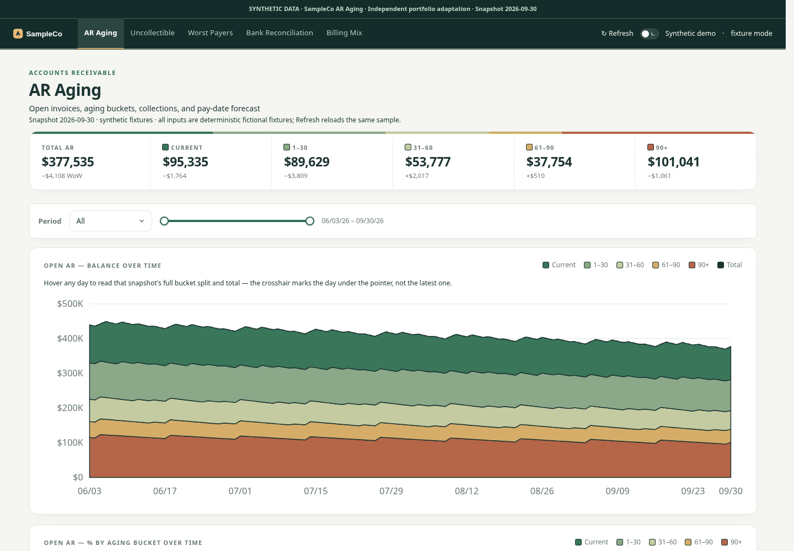
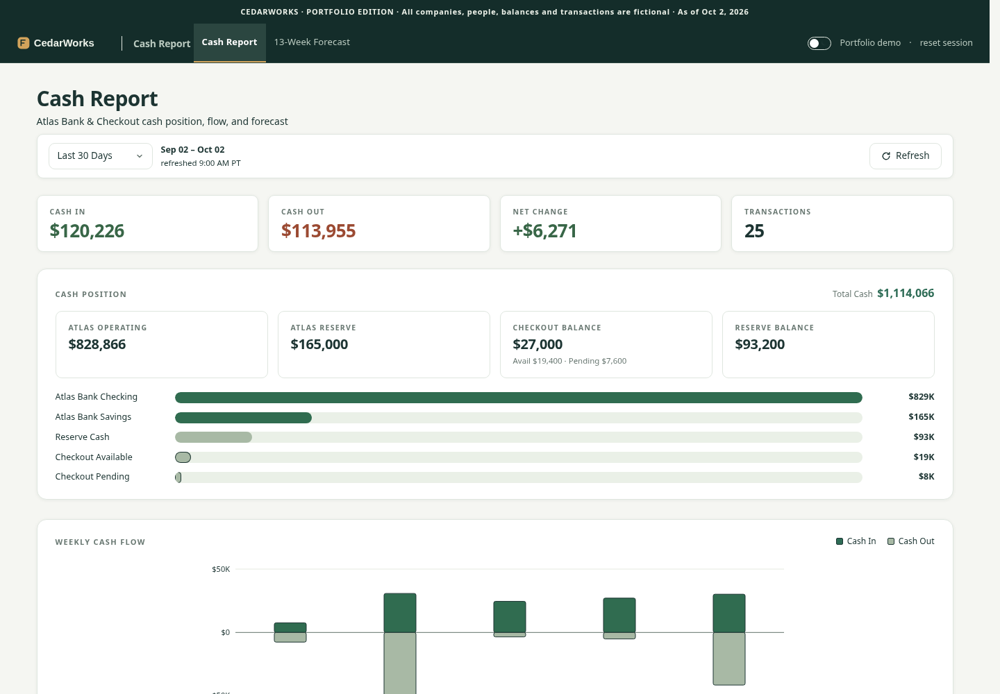
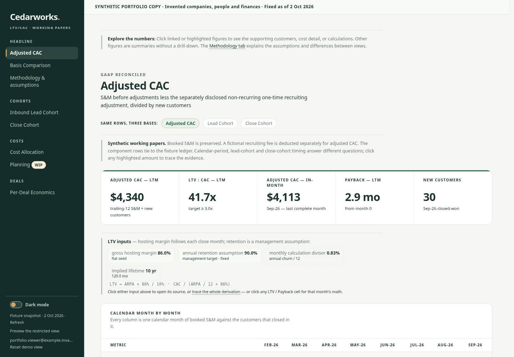

# Andrew Bushek · Finance & product portfolio

Four visual walkthroughs of financial tools, from receivables and cash planning to acquisition economics and shared household spending.

**All figures, accounts, organizations, and people shown are fictional demo data.** This repository contains screenshots and project summaries only.

[AR aging](#ar-aging) · [Cash reporting](#cash-reporting) · [LTV / CAC](#ltv--cac) · [Household finance](#household-finance)

Select any screenshot to see it at full size.

## AR aging

**The question:** Where is cash tied up, and which invoices need attention first?

- Review receivables across current, 1–30, 31–60, 61–90, and 90+ day buckets
- Connect invoice exposure with collection behavior and payer priority
- Inspect bank-match candidates and billing cadence alongside supporting detail

**Walkthrough:** Start with the aging mix and balance trend. Move into an overdue invoice list, compare payment behavior, and inspect the evidence behind a possible bank match before making an allocation decision.

The trend is illustrative demo history. Match candidates support human review and do not post payments or accounting entries.

## Cash reporting

**The question:** What is available now, and how could cash change over the next 13 weeks?

- Bring balances, inflows, outflows, and transactions into one review
- Connect a 13-week forecast to collection and payment timing
- Explore assumptions, payment scenarios, and forecast review trails

**Walkthrough:** Establish the current cash position, then follow the forecast into a week that needs attention. Trace a large receipt or payment to its assumptions and compare how a timing change affects the cash path.

Forecasts are assumption-driven illustrations. These visuals make no claim about realized forecast accuracy or business results.

## LTV / CAC

**The question:** Why do plausible acquisition-economics calculations give different answers?

- Compare adjusted CAC, lead-cohort, and close-cohort views
- Trace costs through allocations and per-deal economics
- Make timing, cohort maturity, margin, and retention assumptions visible

**Walkthrough:** Begin with the headline metrics, compare the three calculation bases, and follow a highlighted amount into its supporting detail. Use the methodology view to explain which population, timing, and assumptions each answer represents.

Modeled lifetime value is sensitive to retention, margin, and horizon. It is not realized customer profit, and an immature cohort window is not a zero.

## Household finance

**The question:** How can two people understand shared spending without turning everyday life into accounting work?

- See spending, the remaining monthly plan, and who owes whom together
- Keep shared expenses, trips, currencies, and split rules connected
- Distinguish posted expenses from planned items and items needing review
- Use the same overview on desktop and mobile

**Walkthrough:** Start with the household overview, review recent expenses, and inspect the split behind the settlement balance. Keep upcoming trip costs separate from posted spending so the monthly picture stays clear.

### Mobile view

The household, merchants, trip, budget, and settlement amounts are entirely fictional.

---

These are visual case studies. Interface controls in the screenshots are not interactive in this repository.
